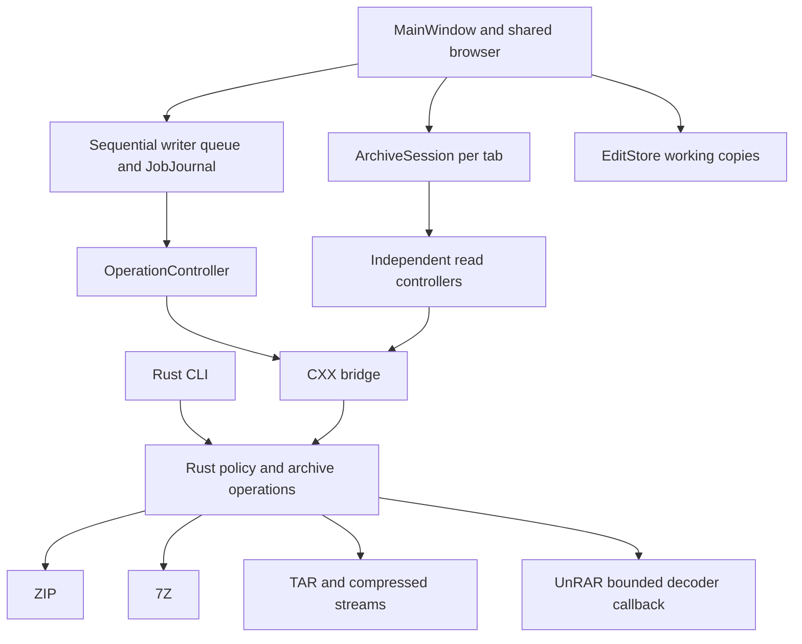

# Architecture

VYNX ARC uses C++20 / Qt Widgets and a Rust core statically linked through CXX.
Qt is deployed beside the application. No service, telemetry, network client or
external archiver participates in archive operations.

0.9 adds an independent `rars` RAR5 encoder alongside the existing UnRAR reader.
Both GUI and RAR CLI create/modify use supervised workers. RAR5 rebuilds use
one anonymous spool; managed writer quotas and supervisor-owned backend scratch
bound resource use. See [NATIVE_RAR.md](NATIVE_RAR.md). Persisted settings,
working-copy records and journal schemas remain compatible; wire protocol is 4.

Each ArchiveSession owns its archive handle, password in memory, model/filter,
folder history, query, selection, columns, scroll position and busy state. A shared
browser binds to the selected session. Completion callbacks bind to the operation's
owner before updating it, then restore the selected tab. One primary operation runs
at a time; a bounded preview on another idle tab may use an independent controller.
There are no parallel writers. Closing a busy tab cancels and defers destruction.

Archive metadata becomes PreparedArchive on the worker thread. The GUI adopts the
prepared rows without converting Rust strings again. Search rows/root are cached;
folder caches are bounded by row and member-ID costs. Locale sort keys avoid repeated
name collation. Filtering uses cached literal text and direct row values.

JobJournal writes a schema-versioned JSON document with QSaveFile and holds a
per-instance QLockFile. It accepts a whitelist of typed job fields and stores no
passwords or file content. Limits: 1 MiB, 96 records. On restart running/pending jobs
become interrupted and require explicit review. An incomplete bounded descriptor
is explicitly non-replayable, avoiding partial restored selections. Source size/mtime snapshots are
review hints, not cryptographic identity. Retrying creates a new linked record.
Disabling local history removes the journal and workspace paths.

EditStore keeps up to 32 registered editable copies separately from disposable
external views. Manifests and content survive process restart; no age cleanup deletes
these copies. Flat owned-directory checks reject links/reparse points and unexpected
subdirectories. A metadata fingerprint drives the UI indicator; save integrity uses
SHA-256 under file locks, not that fingerprint. Explicit save rebuilds ZIP/7Z/RAR5,
verifies payload and manifest, flushes, then publishes. The digest receipt is computed
before publication so post-commit cancellation cannot report a false failure.
Encryption and supported metadata are preserved. Failure retains the edited copy.

Extraction validates full metadata before output, rejects links and ambiguous Windows
paths, and publishes each completed file from a unique sibling temporary file. ZIP
preview validates the metadata policy and only decodes the selected member; full
archive testing remains separate. Solid 7Z may require decoding a shared block.

See [SECURITY_MODEL.md](SECURITY_MODEL.md) for parser-allocation and hostile-local-
process race limits, and [IMPLEMENTATION_STATUS.md](IMPLEMENTATION_STATUS.md) for the
current verification evidence. Earlier milestone reports remain historical.
