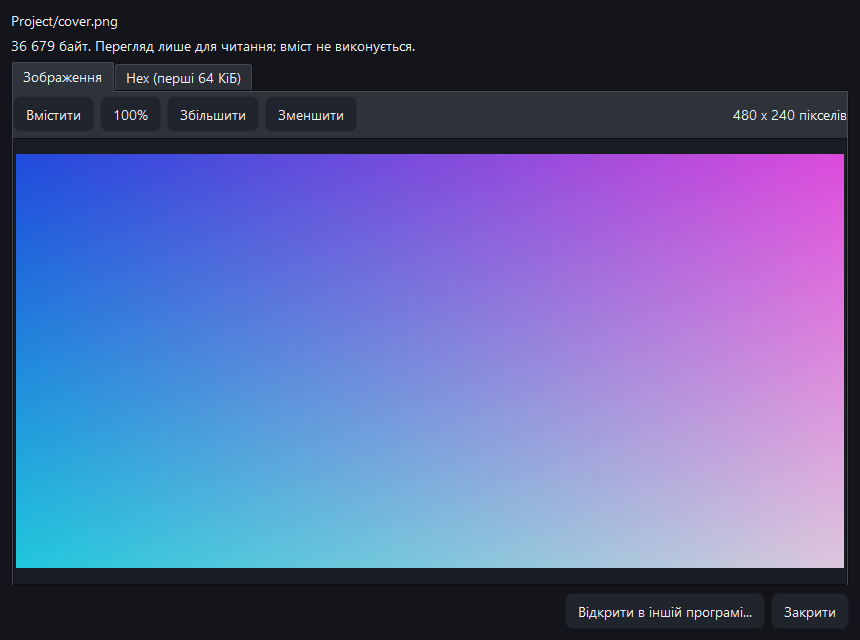
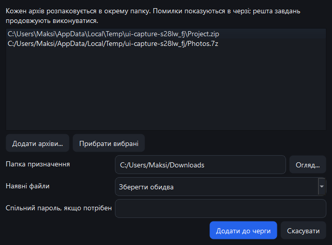
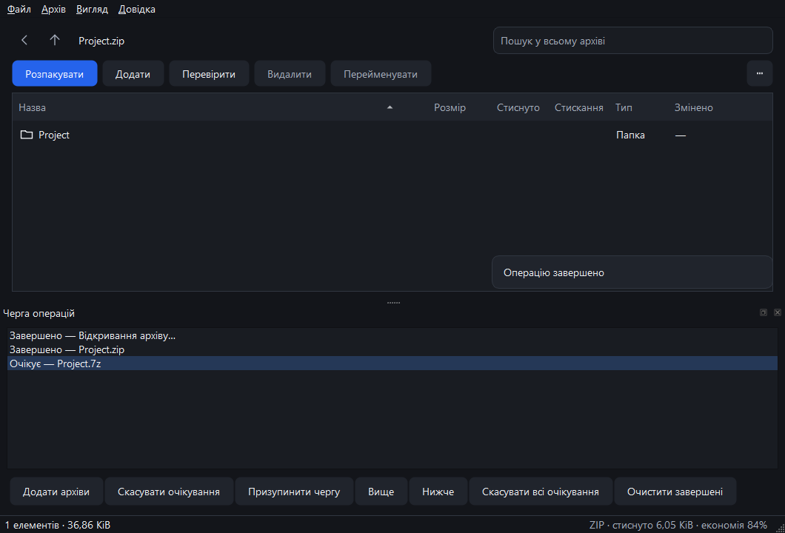

# VYNX ARC 0.4.0 development milestone

Date: 2026-10-16. The milestone is a product feature increment, not a claim of
complete V1 or production qualification. GUI application version, Rust package
versions, CLI help, installer and Explorer package identity are 0.4.0 (identity
0.4.0.0). Validation below was captured before committing and tagging. The `v0.4.0` tag
identifies this development milestone; remote CI results are tracked separately.

## Completed product scope

| Scenario | Behavior |
| --- | --- |
| Preview a file | Double-click, Enter or F3 opens searchable text, raster image or Hex tabs. |
| Text | Strict UTF-8 and BOM-marked UTF-16 LE/BE; literal text, including HTML; find next/previous wraps. |
| Images | PNG/JPEG/BMP/GIF/WebP, first frame, fit/100%/zoom/panning; no SVG or document execution. |
| Binary | Hex offsets, bytes and printable characters for the first 64 KiB. |
| External opening | Ctrl+Enter or Open externally asks for consent, verifies a temporary copy and invokes the associated OS application. |
| Batch extraction | Ctrl+Shift+E selects up to 32 archives, destination, optional shared password and conflict policy. Each archive has a distinct folder. |
| Queue | Pause/resume, move pending jobs up/down, cancel selected/all pending, clear history, double-click for details. |
| Queue creation | Creation dialogs capture settings/passwords before enqueueing; later preference changes do not modify pending requests. |
| Failures | A failed batch archive retains its error in the queue and remaining requests continue. Cancellation affects the selected running/pending jobs. |

The previously implemented 12 writable formats, RAR read support, resource modes,
encryption, whole-archive search, hashes and transactional ZIP/7Z modification
remain available.

## Limits and temporary file behavior

- Internal content is verified before display, limited to 16 MiB. Text rendering
  is limited to 4 MiB. Larger files should be extracted.
- Images are limited to 16 million pixels, 16384 pixels on either axis and a
  64 MiB Qt allocation limit. These settings do not sandbox native decoders.
- External materialization accepts one regular file up to 256 MiB. Output uses
  a unique per-user directory, no-clobber publication, read-only attributes and
  Windows ZoneId=3. An allowlist excludes executable/script/shortcut/HTML/SVG/
  macro-Office extensions. Read-only attributes are advisory.
- The external opening confirmation explains plaintext storage, no save-back,
  and possible copies retained by other applications. Owned temporary directories
  older than seven days are cleaned at startup when not locked by a live VYNX
  session. File-sharing errors or unsafe directory contents can defer cleanup.
- The OS association dispatch is tested with an intercepted file URL handler;
  actual third-party PDF/Office/media application behavior is not qualified by
  this test. No installed application is launched by that automated check.
- Queue capacity is 32 pending and 64 finished rows. History is in memory;
  pause applies to queued work and does not interrupt a running job. Batch
  extraction is not a transaction across every archive. Existing destination
  content follows the chosen Keep both/Skip/Replace/Stop conflict policy.
- Modifying existing ZIP/7Z retains the prior rebuild compression policy;
  creation presets do not yet configure modification.

## Verification and artifacts

The reproducible entry point is `scripts/build-release.ps1`, which runs Rust
formatting, Clippy with warnings denied, all Rust tests, cargo audit denying
all yanked dependencies, the MSVC Release build and three CTest targets before
packaging. Qt presentation tests also write `build-msvc/presentation-tests.txt`.

New regression coverage checks all-format binary previews, encrypted/read-only
materialization, ZoneId=3, corruption rejection without publication, no-clobber
behavior, cancellation and size/path limits. GUI checks cover UTF-16 and broken
UTF sequences, literal HTML, image/Hex views, text search, owned-file URL dispatch,
live-cache cleanup exclusion, aged-cache cleanup and queue reordering.

The real GUI smoke dispatches a paused three-archive batch containing an invalid
middle archive, resumes it, verifies both output files and checks that the failed
request remains reported. These are real worker/core calls, separate from the
explicit screenshot fixtures.

Local evidence lives in `.dev/milestone-0.4/`. The final package gate runs all
74 Rust tests and all 3 CTest targets successfully; the Qt presentation suite
reports 15 passing cases including initialization/cleanup. Cargo audit passes
with yanked dependencies denied. The packaged app passes the same real GUI smoke
with only Windows/System32 on PATH and no developer Qt environment.

Independent portable verification covers all 12 writable formats, ZIP/7Z
modification, split 7Z and RAR multipart. All five standalone stream formats are
checked in both directions with independent Python codecs. The packaged CLI
passes 512 deterministic bounded parser mutations, 6 cross-process lock checks
and the 1,400-publication project-path stress matrix. The last queue layout fixes
change only the GUI; its companion CLI is byte-identical to those tested runs.

Screenshot captures cover 16 states in both themes for Ukrainian/Russian and
an English 620x440 window (96 captures). Inspection found narrow queue overflow;
it was corrected and the queue was recaptured in all three languages (both
themes). UI screenshots use explicit fixture scenes, while the packaged smoke
uses real archive operations. Full local logs and individual hashes remain in
the evidence directory; [VERIFICATION_0_4.json](VERIFICATION_0_4.json) records a
compact durable summary. The packages remain unsigned development builds. Artifacts
are `dist/VYNX-ARC-Portable-x64.zip`, `dist/VYNX-ARC-Setup-x64.exe` and
`dist/SHA256SUMS.txt`.

Final portable SHA-256:
`556d590175b41a13a0e6981425580b615c49be5b619032717d974a9d85d52525`.

## Interface samples

## Further product work

The next development areas are durable queue/history, per-job retry configuration,
large-archive performance, richer document preview and explicit edit/save-back.
The current external-opening workflow deliberately does not silently modify the
archive when another application edits a temporary copy.
